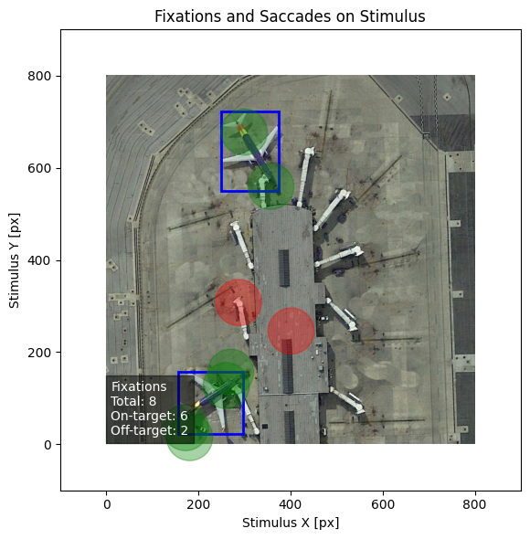

# eeg-eye-tracking-fixations

Trying to classify whether a fixation lands on a target (airplanes in aerial images) from EEG and eye tracking,
using the [EEGET-RSOD](https://figshare.com/articles/dataset/EEGET-RSOD/26943565) dataset. Tried EEGNet, CBraMod,
CSP and random forests on EEG / eye-tracking features. Report is in `docs/report.pdf`.



Balanced accuracy:

| model | pooled | leave-one-subject-out |
|---|---|---|
| RF (EEG features) | 0.69 | 0.51 |
| RF (eye-tracking features) | 0.67 | 0.67 |
| CSP | 0.56 | 0.50 |
| CBraMod | 0.55 | 0.50 |
| EEGNet | 0.54 | 0.50 |

So EEG works somewhat when subjects are pooled but basically not on new subjects, eye tracking does.

To run:

```
pip install -r requirements.txt
python -m data.run_data_preparation
python -m classification.run_optimization
python -m classification.run_evaluation
```

Data prep downloads the whole dataset (several GB) and takes a while.
